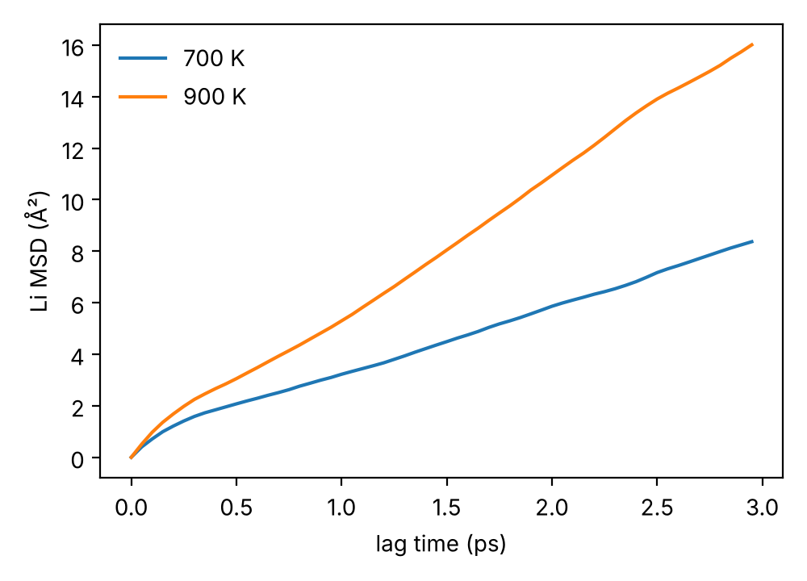

# Li-ion diffusion in β-Li₃PS₄ with a universal MLIP

A small, self-contained workflow that estimates Li-ion diffusivity in the sulfide solid electrolyte **β-Li₃PS₄** using molecular dynamics driven by a universal machine-learning interatomic potential (MACE-MP) in [ASE](https://wiki.fysik.dtu.dk/ase/).

```
build β-Li₃PS₄ (Pnma, ordered Li)  →  MLIP relaxation  →  NVT MD at several T (Bussi thermostat)
        →  Li mean-squared displacement  →  D(T), anisotropy  →  Arrhenius fit (Eₐ)  →  Nernst–Einstein σ
```

## Quick start

```bash
pip install -r requirements.txt
pytest                                   # unit tests for the analysis code

# smoke test on a laptop CPU (64 atoms, ~7 ps per temperature, ~8 min each)
python scripts/run_md.py --temps 700 900 --steps 3500 --equil-steps 500 --interval 25 \
       --supercell 1 1 2 --out runs/smoke_test
python scripts/analyze.py runs/smoke_test

# production on a GPU (128 atoms, 100 ps per temperature)
python scripts/run_md.py --temps 600 700 800 900 1000 --steps 50000 --device cuda --out runs/prod
python scripts/analyze.py runs/prod
```

`hpc/run_md_job.sh` is a template batch script for a Grid-Engine GPU cluster.

## Method

| Step | Choice | Why |
|---|---|---|
| Structure | β-Li₃PS₄, Pnma, 32-atom cell (Li12P4S16). Li fully on 8d + 4b, 4c empty (ordered model of the partially occupied experimental structure). Coordinates and lattice: Stöffler et al., tabulated in the SI of *J. Mater. Chem. A* 2020, DOI 10.1039/D0TA02805C. The high-temperature refinement of Homma et al. (*Solid State Ionics* 182, 53, 2011) is COD entry 1570310 and can be used via `--cif`. | Standard ordered model used in DFT studies of β-Li₃PS₄ |
| Potential | MACE-MP-0 (`small` by default; `medium` / `large` via `--model`) | Open universal MLIP (MIT licence) |
| Relaxation | FIRE on atomic positions at the experimental lattice (`--relax-cell` also relaxes the cell) | MD at the measured density; the uMLIP equilibrium cell is distorted (a +7 %, c −3 % with MACE-MP-0 small) |
| MD | NVT, Bussi stochastic velocity rescaling (τ = 100 fs), Δt = 2 fs, unwrapped positions every 50 steps | Bussi keeps the dynamics close to Newtonian, which matters for transport |
| Analysis | Windowed MSD over all time origins with centre-of-mass drift removed; D from a linear fit in the diffusive regime (20–80 % of lag range); per-axis D for anisotropy; Arrhenius fit; Nernst–Einstein σ with Haven ratio 1 | |

## Smoke-test result (not converged)

64 atoms, 6 ps of production per temperature on 2 CPU cores (`runs/smoke_test/`):

| T (K) | D_Li (cm²/s) | D_x / D_y / D_z (10⁻⁵ cm²/s) |
|---|---|---|
| 700 | 4.3 × 10⁻⁵ | 4.8 / 2.5 / 5.5 |
| 900 | 9.2 × 10⁻⁵ | 7.4 / 9.3 / 11.0 |



The P and S sublattices stay intact (MSD < 1 Ų, plateaued) while Li diffuses. With only two temperatures and a few picoseconds this is a check that the pipeline works, **not** a converged result: the apparent Eₐ ≈ 0.21 eV and the extrapolated room-temperature σ ≈ 5 × 10⁻² S/cm are far above experiment (≈ 1.6 × 10⁻⁴ S/cm for nanoporous β-Li₃PS₄; Liu et al., *J. Am. Chem. Soc.* 135, 975, 2013).

## Known limitations and next steps

- **Statistics.** Production runs need ≥ 100 ps per temperature, ≥ 4 temperatures, a larger cell (≥ 1×2×2) and several seeds for error bars.
- **Universal-MLIP softening.** Universal MLIPs trained mostly on near-equilibrium DFT data tend to underestimate energy curvature and migration barriers, which overestimates diffusivity (Deng et al., "Overcoming systematic softening in universal machine learning interatomic potentials by fine-tuning", 2024). Planned comparison: MACE-MP small vs. medium, other universal MLIPs, and a model fine-tuned on Li–P–S DFT data.
- **Li ordering.** Different ordered Li configurations of the partially occupied structure should be sampled.
- **High-T extrapolation.** β-Li₃PS₄ is the high-temperature polymorph; extrapolating MD at 600–1000 K to 300 K assumes a single mechanism.

## Layout

```
li3ps4md/structure.py   β-Li₃PS₄ builder and overlap check
li3ps4md/md.py          MACE-MP calculator, relaxation, Bussi NVT MD with unwrapped trajectory output
li3ps4md/analysis.py    MSD, diffusion fit, Arrhenius, Nernst–Einstein
scripts/run_md.py       relax + MD at several temperatures
scripts/analyze.py      D(T), Arrhenius fit, figures, results.json
tests/                  unit tests (random walk with known D, Arrhenius, structure)
```

## References

- I. Batatia et al., "A foundation model for atomistic materials chemistry", arXiv:2401.00096 (MACE-MP-0).
- A. H. Larsen et al., "The atomic simulation environment — a Python library for working with atoms", *J. Phys.: Condens. Matter* 29, 273002 (2017).
- G. Bussi, D. Donadio, M. Parrinello, "Canonical sampling through velocity rescaling", *J. Chem. Phys.* 126, 014101 (2007).

## Author

Fanze Meng · [dmpoolm.github.io](https://dmpoolm.github.io)
